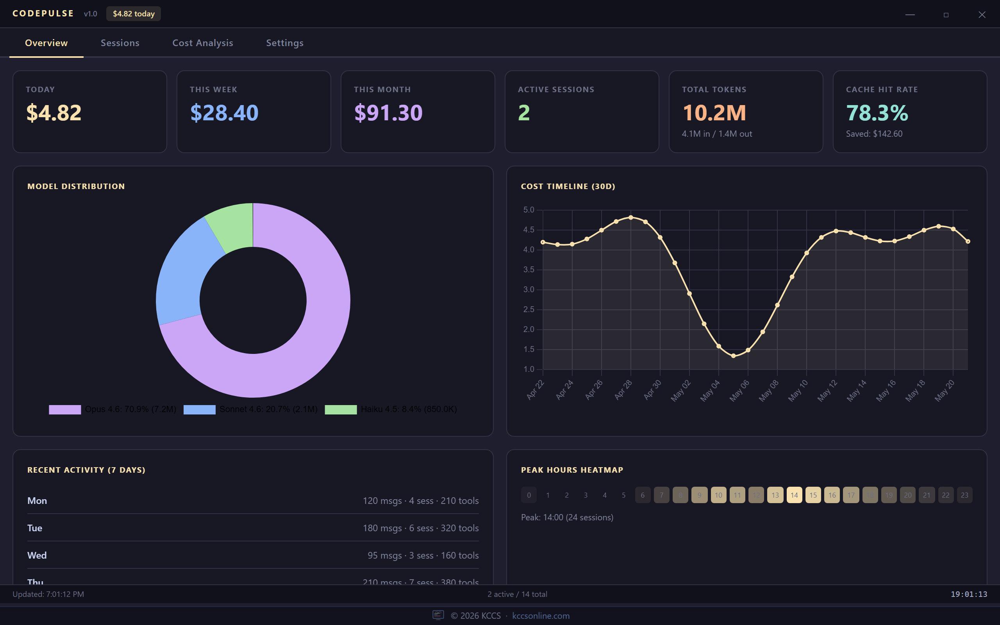
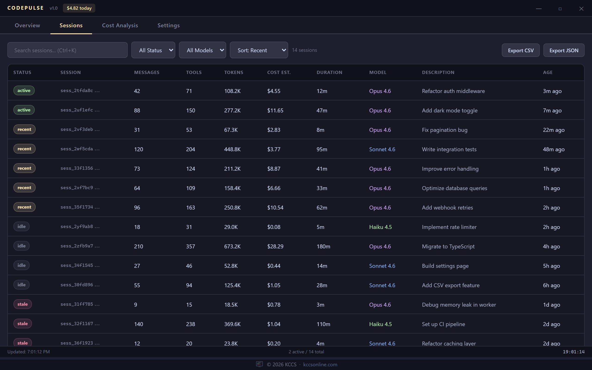
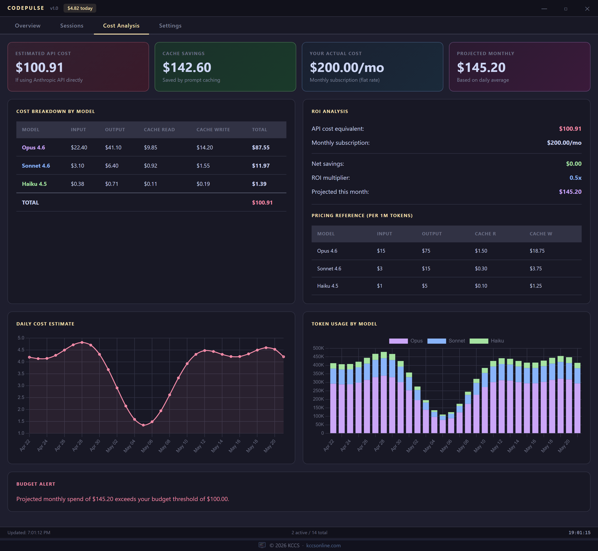
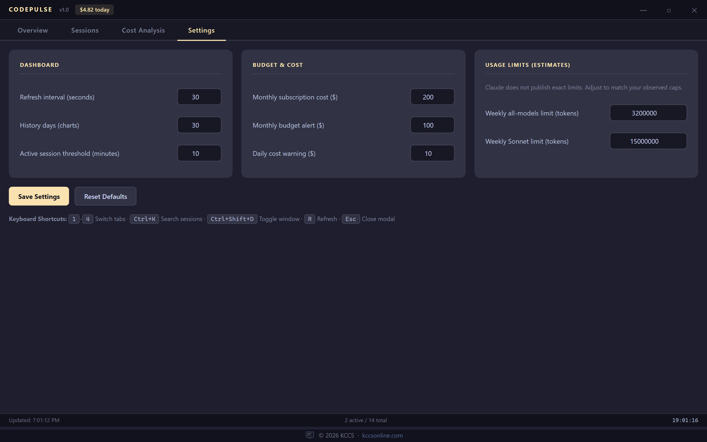

```
 ██████╗ ██████╗ ██████╗ ███████╗██████╗ ██╗   ██╗██╗     ███████╗███████╗
██╔════╝██╔═══██╗██╔══██╗██╔════╝██╔══██╗██║   ██║██║     ██╔════╝██╔════╝
██║     ██║   ██║██║  ██║█████╗  ██████╔╝██║   ██║██║     ███████╗█████╗
██║     ██║   ██║██║  ██║██╔══╝  ██╔═══╝ ██║   ██║██║     ╚════██║██╔══╝
╚██████╗╚██████╔╝██████╔╝███████╗██║     ╚██████╔╝███████╗███████║███████╗
 ╚═════╝ ╚═════╝ ╚═════╝ ╚══════╝╚═╝      ╚═════╝ ╚══════╝╚══════╝╚══════╝
        ♥  real-time cost & token analytics for Claude Code  ♥
```

<p align="center">
  
  
  
  
  
</p>

> **Know exactly what Claude Code is costing you.** CodePulse reads the local stats-cache and session transcript files that Claude Code writes to your machine and shows you a real-time breakdown of token usage, API cost equivalents, cache savings, and session analytics — all without sending a single byte to any external server.

---

## Screenshots

| Overview | Sessions |
|----------|----------|
|  |  |

| Cost Analysis | Settings |
|---------------|----------|
|  |  |

---

## Features

- **Cost tracking** — today / last 7 days / month-to-date cost estimates, priced per model from Anthropic's published API list prices (Claude 5.x, 4.x and 3.x families)
- **Session analytics** — browse, search, filter, and sort every Claude Code session with full details
- **ROI comparison** — see how much API cost your subscription saves you vs. paying per-token
- **Budget alerts** — get native OS notifications when projected monthly spend exceeds your threshold (once per day, no spam)
- **Cache savings** — calculates how much prompt caching saved you vs. sending full input tokens
- **Hour heatmap** — see when you use Claude Code most during the day
- **Export** — export session data to CSV or JSON for your own analysis
- **System tray** — runs in the background, shows today's cost in the tray tooltip
- **File watcher** — auto-refreshes when Claude Code writes new session data
- **Keyboard shortcuts** — navigate without touching the mouse

---

## Tabs

### Overview
The at-a-glance dashboard. Six stat cards across the top (today, week, month, active sessions, total tokens, cache hit rate), a model distribution doughnut chart, a 30-day cost timeline, recent activity for the last 7 days, and a 24-hour usage heatmap.

### Sessions
Every Claude Code session as a sortable, filterable table. Search by description, working directory, or session ID. Filter by status (active/recent/idle/stale) and model family. Sort by recency, token count, cost, messages, or duration. Click any row for a detail modal. Paginates at 50 rows per page. Export the sessions matching the current search/filters to CSV or JSON. Session cost includes any sub-agent (Task tool) transcripts belonging to that session.

### Cost Analysis
Deep cost breakdown by model: input tokens, output tokens, cache read, cache write, and total — all using real per-model pricing from the Anthropic API pricing sheet. ROI analysis shows your API cost equivalent vs. your subscription cost and the net savings multiplier. Daily cost chart and token-by-model stacked bar chart. Budget alert banner when projected monthly spend is over threshold.

### Settings
Configure refresh interval, history window, active session threshold, monthly subscription cost (used in ROI calculation), monthly budget alert threshold, daily cost warning, and estimated weekly token limits. All settings persist to `dashboard-config.json` in the app's user-data folder (see Configuration).

---

## Installation

### Run from source

```bash
git clone https://github.com/pueblokc/codepulse.git
cd codepulse
npm install
npm start
```

### Build a Windows installer

```bash
npm install
npm run build
# Installer and portable exe appear in dist/
```

---

## Build Instructions

Requires Node.js 20+ and npm.

```bash
# Install deps (includes electron-builder as dev dep)
npm install

# Run in dev mode
npm start

# Build Windows NSIS installer + portable exe
npm run build

# Build to directory only (faster, no installer)
npm run build:dir

# Lint and run the test suite
npm run lint
npm test
```

The `dist/` folder will contain:
- `CodePulse Setup x.x.x.exe` — NSIS installer with optional install directory
- `CodePulse x.x.x.exe` — standalone portable executable

---

## Configuration

Settings are stored in `dashboard-config.json` in Electron's per-user app data folder (`app.getPath('userData')` — typically `%APPDATA%\CodePulse` on Windows; the folder name follows the app name). A `dashboard-config.json` left next to the app by v1.0.0 is still read as a fallback. You can edit settings through the Settings tab or directly in the file; out-of-range values are clamped.

| Setting | Default | Description |
|---------|---------|-------------|
| `refreshIntervalMs` | `30000` | How often to reload data (milliseconds, 5000–300000) |
| `historyDays` | `30` | How many days of history to show in charts (7–365) |
| `activeThresholdMinutes` | `10` | Minutes since last write before a session is "recent" not "active" (1–60) |
| `monthlySubscriptionCost` | `200` | Your actual Claude subscription cost, used in ROI calculation |
| `budgetThreshold` | `100` | Projected monthly API cost that triggers a budget alert notification |
| `dailyBudgetWarn` | `10` | Today's cost above this shows a warning under the Today card |
| `weeklyAllModelsLimit` | `3200000` | Estimated weekly token cap across all models (stored only; not yet shown in the UI) |
| `weeklySonnetLimit` | `15000000` | Estimated weekly Sonnet token cap (stored only; not yet shown in the UI) |
| `lastBudgetAlertDate` | `null` | Auto-managed: date of last OS budget notification (prevents spam) |

---

## FAQ

**Where is the data stored?**
CodePulse reads `~/.claude/stats-cache.json` and the session transcripts under `~/.claude/projects/` (`<project>/<session-id>.jsonl`, sub-agent transcripts in `<project>/<session-id>/subagents/`, and the older `<project>/sessions/*.jsonl` layout). If you set `CLAUDE_CONFIG_DIR` for Claude Code, CodePulse uses it too. It never writes to these files and makes no network requests.

**Does it upload anything?**
No. CodePulse is 100% local. No analytics, no telemetry, no external API calls. It only reads files from your local disk.

**Why does the cost show "$0.00" even though I've used Claude Code?**
Check that `~/.claude/projects/` contains `.jsonl` transcripts (or that `CLAUDE_CONFIG_DIR` points at the right folder). Today/week/month costs come from those transcripts; the all-time totals come from `~/.claude/stats-cache.json`, which Claude Code only recomputes periodically, so all-time figures can lag behind today's.

**How accurate are the cost estimates?**
For days that still have transcripts on disk, costs are computed per API response from the exact input / output / cache-read / cache-write (5-minute and 1-hour) token counts and the model that served it, with duplicate lines de-duplicated. Older days (Claude Code deletes old transcripts, 30 days by default) fall back to `stats-cache.json`, whose daily `tokensByModel` field is a single combined count, so a blended (input+output)/2 rate is used and cache tokens are not included. All-time totals use `modelUsage` from the stats-cache. These are list-price API equivalents, not billing data: batch, fast-mode, long-context premiums and cloud-partner pricing are not modelled. Prices are in `lib/pricing.js`.

**What does "Cache Hit Rate" mean?**
When Claude Code sends the same context repeatedly, Anthropic can serve it from cache at a much lower token rate. The cache hit rate is the percentage of input tokens served from cache vs. fresh. Higher is better — it means you're saving money.

**What is "Your Actual Cost" in the Cost Analysis tab?**
That is your configured monthly subscription cost (default $200/mo for Claude Max). You can change it in Settings. It is used in the ROI calculation to show how much the subscription saves you vs. paying API rates.

**Can I run this on macOS or Linux?**
Yes. The app is cross-platform. Use `npm start` to run from source. To build for macOS or Linux, add targets to the `build` section in `package.json` (e.g., `"mac": { "target": ["dmg"] }`).

**The window disappears — where did it go?**
CodePulse minimizes to the system tray instead of closing. Click the tray icon to show it again, or press `Ctrl+Shift+D` (`Cmd+Shift+D` on macOS).

---

## Keyboard Shortcuts

| Key | Action |
|-----|--------|
| `1` | Overview tab |
| `2` | Sessions tab |
| `3` | Cost Analysis tab |
| `4` | Settings tab |
| `Ctrl+K` | Focus session search |
| `Ctrl+Shift+D` / `Cmd+Shift+D` | Toggle window (global) |
| `R` | Refresh data |
| `Esc` | Close modal |

---

## Tech Stack

- **Electron 44** — cross-platform desktop shell (sandboxed renderer, context isolation)
- **Chart.js 4** — cost timeline, model distribution, token usage charts
- **Chokidar 4** — file watcher for auto-refresh when Claude Code writes session data
- **Catppuccin Mocha** — dark color palette
- Vanilla JS renderer — no React, no bundler, no build step for the UI
- `node:test` + ESLint, run in GitHub Actions — see [ARCHITECTURE.md](ARCHITECTURE.md) for how the pieces fit

---

## Author

Built by [KCCS](https://kccsonline.com) — `info@kccsonline.com`

Source: [github.com/pueblokc/codepulse](https://github.com/pueblokc/codepulse)

---

*CodePulse is not affiliated with Anthropic. Claude is a trademark of Anthropic PBC.*
